# Games Club

A self-hosted web app for running a monthly games club with friends: suggest games, pick the next one by vote or spin wheel, play it together, then write up what everyone thought of it. Every played month stays in an archive you can browse later.

Built with [TanStack Start](https://tanstack.com/start) (React 19 + SSR + server functions), Tailwind CSS v4, SQLite and Bun. One Docker container, one database file, no external services required.

---

## Screenshots — the whole flow

### 1. Sign in

Members sign in with a username and password. There is no email anywhere in the system.

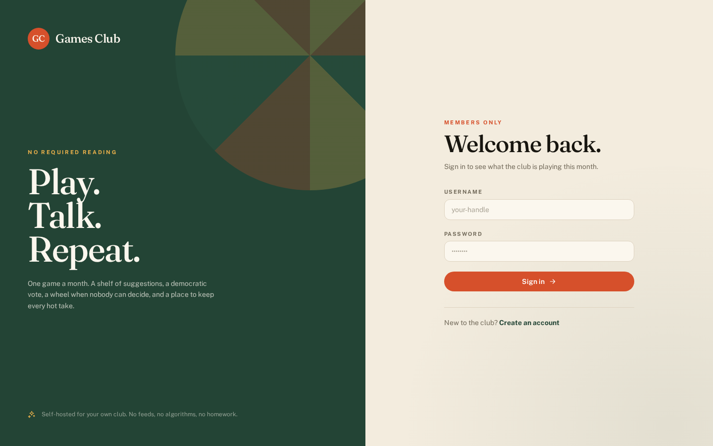

### 2. Join the club

New members register themselves: display name, username, password. The first account created on an empty database becomes the admin (or set `ADMIN_*` env vars — see [Configuration](#configuration)).

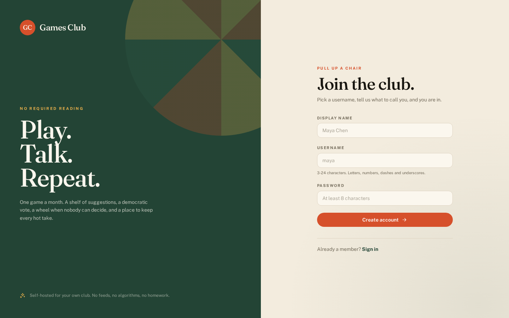

### 3. The club room (dashboard)

The home page shows the **current month's game** up top, what is **coming up**, the games still **waiting on the shelf** (backlog), and recent reviews from played months.

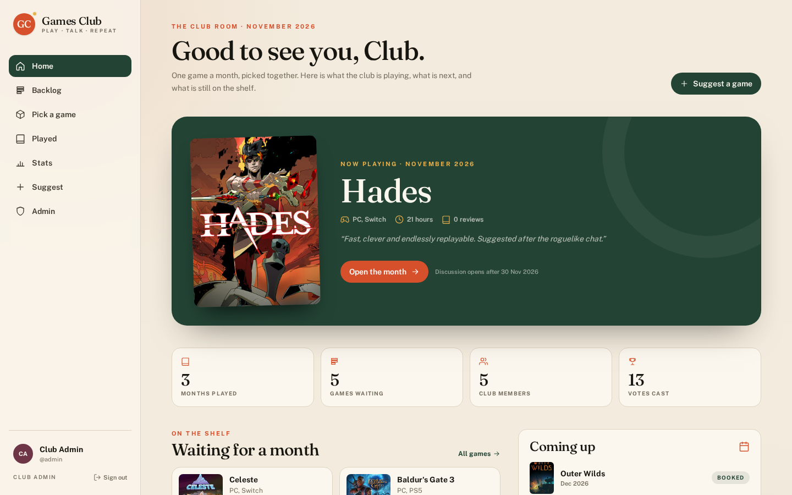

### 4. The backlog

Every suggested-but-unscheduled game lives here, with cover art, platform, time to beat, who suggested it, and how many votes each has.

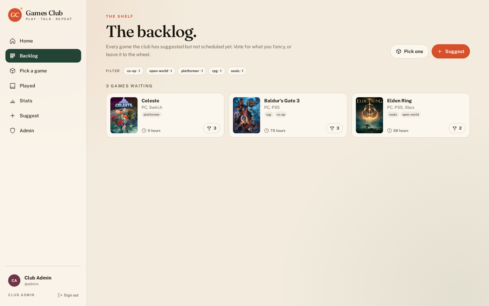

### 5. Picking the next game: spin wheel or voting

On the pick page anyone can **vote** for games on the shelf (one vote per member, changeable at will), or spin the **wheel** to let fate choose. Only an admin locks a picked game into a month.

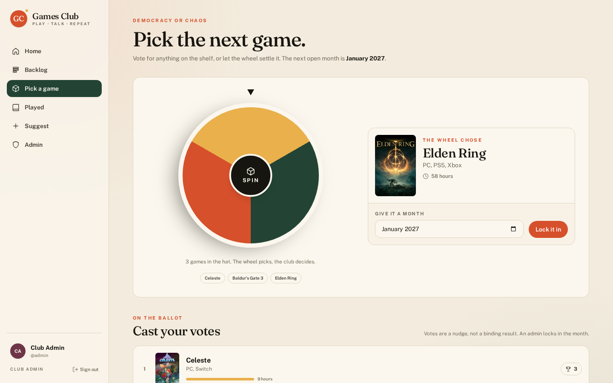

### 6. Suggesting a game

Any member can add a game. If you set `RAWG_API_KEY` on the server, the search box pulls in title, platforms, time to beat, description, Metascore and box art automatically; otherwise everything is entered by hand (the live preview on the right follows along).

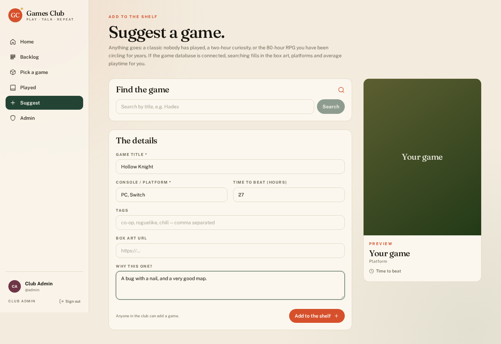

### 7. Game detail

Each game has its own page: cover art, platform, time to beat, club notes, votes, and — once it has been played — what the club said about it.

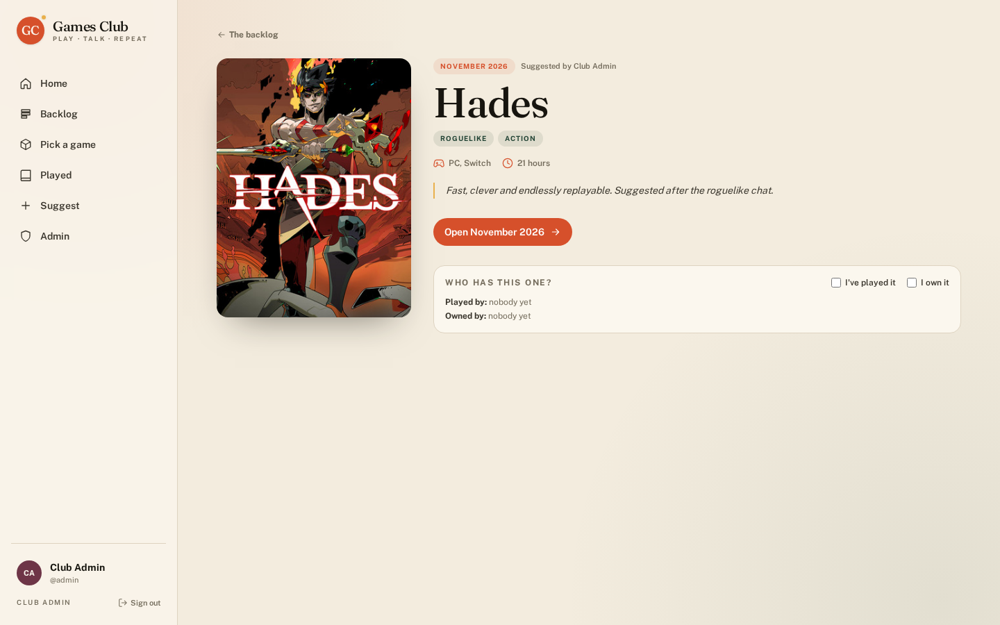

### 8. The current month

While a month is in progress the discussion is closed; the page shows the game, its details and when reviews open (the last day of that month).

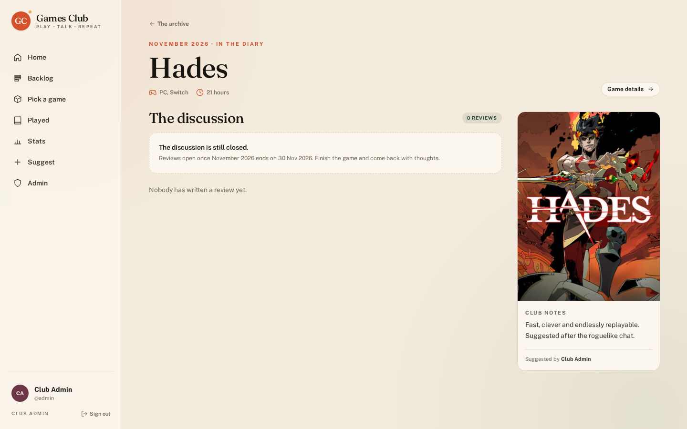

### 9. The archive

Every finished month is listed here with average rating and a taste of the latest review, so anyone can look up what was played and what was said about it.

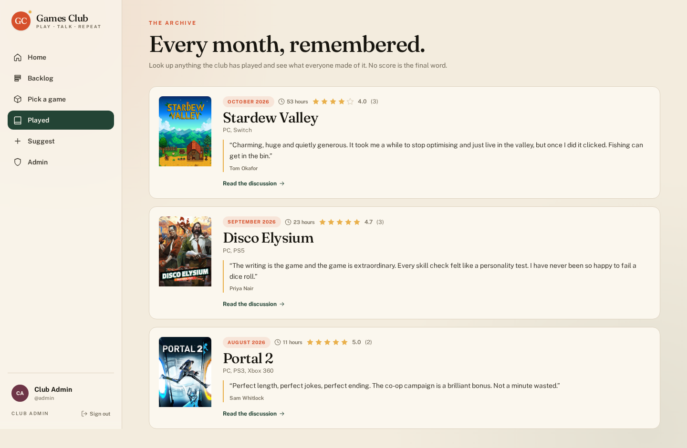

### 10. A played month: reviews and discussion

Once the month ends, every member can post (or edit) their own review with a 1–5 star rating.

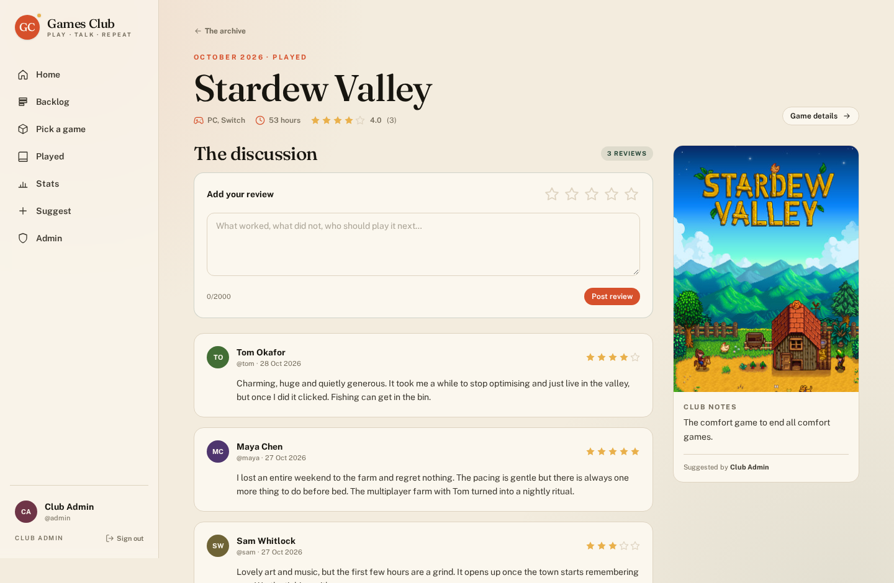

### 11. Admin: members

The single admin account sees all members, when they joined and how many games they have suggested.

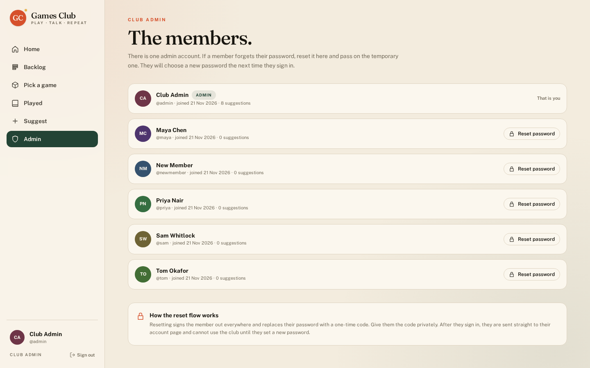

### 12. Admin: password reset (no email)

Locked out? The admin resets a member's password, which signs them out everywhere and shows a **one-time temporary password**. The member signs in with it and is forced to choose a new one before they can do anything else.

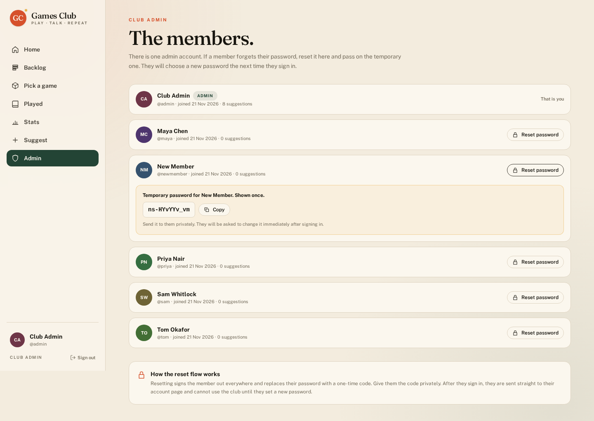

### 13. Your account

Every member can change their own password at any time (and must, right after an admin reset).

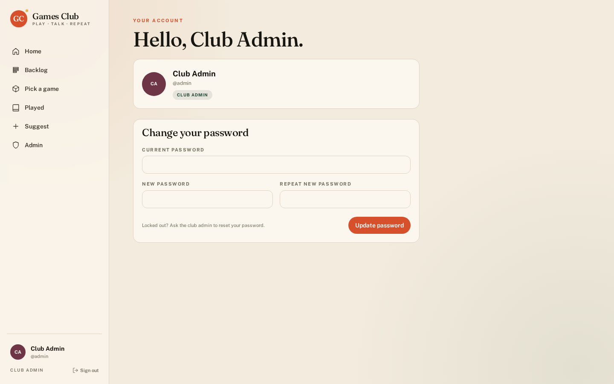

### 14. Stats

Every member can see the club's numbers: most-played genres, best-rated months, whose suggestions age best, and each reviewer's average. Just SELECTs over the existing tables — no new data anywhere.

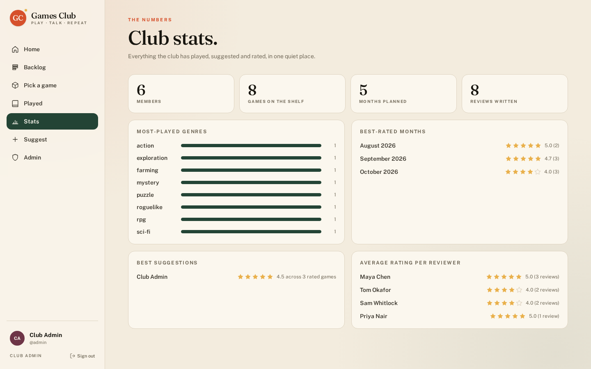

### 15. Mobile

The whole app is responsive; on phones the sidebar collapses into a top bar and pill navigation.

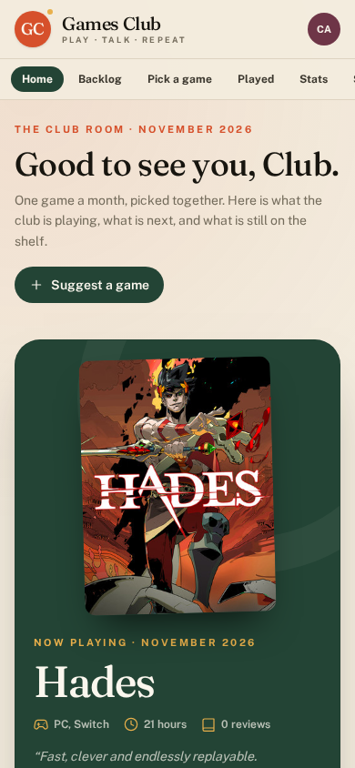

---

## Quick start (Docker Compose — recommended)

Requirements: Docker + Docker Compose on your server. That's it.

```bash
git clone git@github.com:Errol-Hassall/games-club.git
cd games-club
cp .env.example .env        # then edit ADMIN_PASSWORD at minimum
docker compose up -d --build
```

Open <http://your-server:3000>, sign in as `admin` with the password you set, and change it on the account page. Your data lives in the `games-club-data` Docker volume (a single SQLite file).

Live game search is optional. Get a free key at <https://rawg.io/api>, put it in `.env`, then boot (or restart) with:

```bash
# .env
RAWG_API_KEY=your-key-here

docker compose up -d --build
```

With the key set, the suggest form auto-fills title, platforms, time to beat, description, Metascore and box art from RAWG.

To try it with a pre-seeded demo club (members, games, past months with reviews):

```bash
SEED_DEMO=true docker compose up -d --build
# admin / changeme123  (unless you set ADMIN_PASSWORD in .env)
```

### Plain Docker

```bash
docker build -t games-club .
docker run -d --name games-club \
  -p 3000:3000 \
  -v games-club-data:/data \
  -e ADMIN_PASSWORD='pick-something' \
  games-club
```

### Local development (Bun)

Requires [Bun](https://bun.sh) ≥ 1.1.

```bash
bun install
SEED_DEMO=true bun run dev     # http://localhost:3000
```

First boot creates `data/games-club.db`, the admin account (`admin` / `changeme123` by default) and — with `SEED_DEMO=true` — a demo club. Delete the file in `data/` to start over.

## Configuration

All configuration is environment variables (see `.env.example`). There are no required ones.

| Variable         | Default          | Purpose                                                                                     |
| ---------------- | ---------------- | ------------------------------------------------------------------------------------------- |
| `PORT`           | `3000`           | Port the container listens on (compose maps `PORT:3000`).                                    |
| `DATABASE_PATH`  | `./data/games-club.db` | Where the SQLite file lives. Docker uses `/data/games-club.db` (the volume).            |
| `ADMIN_USERNAME` | `admin`          | Username of the single admin account, created on first boot if it does not exist.           |
| `ADMIN_NAME`     | `Club Admin`     | Display name for that account.                                                              |
| `ADMIN_PASSWORD` | `changeme123`    | Password for the admin account (only used when creating it). **Change this.**               |
| `SEED_DEMO`      | `false`          | When `true`, an empty database is filled with a demo club: 4 members, 8 games, 3 played months with reviews, votes. |
| `RAWG_API_KEY`   | *(empty)*        | Optional free key from <https://rawg.io/api>. Enables live game search (title → platforms, time to beat, description, Metascore, box art) in the suggest form. Without it, details are entered by hand. |
| `COOKIE_SECURE`  | `false`          | Set `true` when serving over HTTPS so session cookies get the `Secure` flag.                 |

## How a month works

1. **Suggest** — any member adds games to the shelf (with or without box art).
2. **Pick** — members vote, or someone spins the wheel; an admin assigns the winner to the next open month.
3. **Play** — the dashboard shows "Now playing" for the current calendar month.
4. **Review** — when the month ends, the discussion opens and each member posts a 1–5 star review with their thoughts (one per member, editable).
5. **Archive** — finished months move to the archive with their average rating and all reviews.

## Architecture

Deliberately small: file-based routes, server functions for all mutations/queries, one SQLite file. No ORM, no API layer, no message queue.

```
src/
  routes/            # TanStack Start file-based routes (one component per page)
    __root.tsx       #   shell + auth context (loads the current user once per navigation)
    _auth/           #   /login, /register
    _authed/         #   everything else; redirects to /login when signed out
      index.tsx      #   dashboard: current month, upcoming, backlog, recent reviews
      backlog.tsx    #   unscheduled games
      pick.tsx       #   spin wheel + voting
      suggest.tsx    #   add a game (optional RAWG search)
      game.$gameId.tsx
      month.$month.tsx   #   one month: details + review discussion
      played.tsx     #   archive of finished months
      admin.tsx      #   member list + password reset (admin only)
      account.tsx    #   change own password
  server/            # createServerFn handlers (the only place that touches the DB)
    auth.ts          #   login / register / logout / change password
    session.ts       #   cookie session helpers (token hashed at rest, 30 days)
    club.ts          #   dashboard queries, suggest, vote, assign, review, RAWG search
    admin.ts         #   list users, reset a member's password
  db/index.ts        #   bun:sqlite handle + schema DDL + first-boot seeding
  lib/               #   pure helpers (dates, validation, scrypt password hashing) — unit tested
e2e/                 # Playwright end-to-end tests of the full user flows
scripts/screenshots.ts  # regenerates docs/screenshots for this README
```

Notes:

- **Auth** is a plain cookie session: random 32-byte token in an `httpOnly` cookie, SHA-256 hash stored in SQLite. Passwords are scrypt-hashed with a per-user salt. The admin reset flow issues a one-time temporary password and forces a change on next sign-in — no email infrastructure needed.
- **Game metadata** (platform, time to beat, description, Metascore, box art) is stored per game. With `RAWG_API_KEY` set, the suggest form searches [RAWG](https://rawg.io/api) server-side and pre-fills everything; without it you type it in. Covers are URLs — either an external link or a local upload (stored next to the database) — rendered with a generated fallback tile when missing.
- **Current month** is derived from the server clock (UTC month), so "now playing", "upcoming" and "played" need no manual switching.

## Tech stack

| Concern     | Choice                                             |
| ----------- | -------------------------------------------------- |
| Framework   | [TanStack Start](https://tanstack.com/start) (file-based routing, SSR, server functions) |
| Data        | SQLite via `bun:sqlite` (single file, WAL mode)    |
| Runtime     | [Bun](https://bun.sh)                              |
| Styling     | Tailwind CSS v4 (`@tailwindcss/vite`)              |
| Server      | Nitro node-server preset (self-contained `.output/`) |
| Lint/format | [Biome](https://biomejs.dev/)                      |
| Unit tests  | `bun:test`                                         |
| E2E tests   | [Playwright](https://playwright.dev/) (Chromium)   |
| Container   | Docker / Docker Compose (`oven/bun` image)         |

## Scripts

```bash
bun run dev          # dev server on :3000
bun run build        # production build to .output/
bun run start        # serve the production build
bun run typecheck    # tsc --noEmit (strict)
bun run lint         # biome lint
bun run format       # biome format --write
bun test             # unit tests (src/**/*.test.ts)
bun run test:e2e     # Playwright e2e suite (boots its own server + fresh DB)
bun run scripts/screenshots.ts  # regenerate docs/screenshots for the README
```

## Testing

- **Unit tests** (`bun test src`) cover the pure logic: month arithmetic/formatting, input validation, password hashing/verification, and database bootstrap (admin creation is idempotent; demo seed runs exactly once).
- **E2E tests** (`bun run test:e2e`) drive a real browser against a fresh seeded database and cover the full flows: anonymous redirect + bad-password rejection; register → suggest two games → vote → sign out; spin wheel → admin assigns a month; open a past month → post a review; admin resets a password → member forced to change it on next sign-in.

## CI

Every push and pull request runs `.github/workflows/ci.yml`: Biome lint, strict typecheck, unit tests, production build, then the Playwright e2e suite in a second job.

## Production notes

- **Backups**: copy the SQLite file (or your `/data` volume) — that is the whole state. Stop the container or use `sqlite3 .backup` for a consistent snapshot while it runs.
- **HTTPS**: put it behind a reverse proxy (Caddy/Nginx/Traefik), set `COOKIE_SECURE=true`, and keep `ADMIN_PASSWORD` in your `.env`.
- **Updates**: `git pull && docker compose up -d --build`. The schema is created with `IF NOT EXISTS` on boot; there are no destructive migrations.
